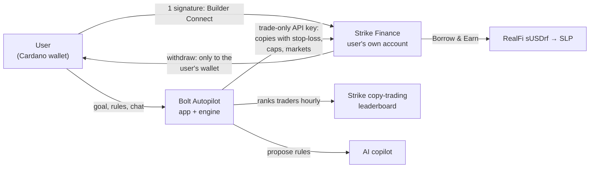

# Bolt Autopilot

**Copy trading on Strike Finance, on autopilot.** Say your goal and Bolt Autopilot copies the best traders on Strike for you, inside hard limits you choose, on your own Strike account. Bolt never holds your money.

- Live: https://autopilot.boltstriker.io (private beta on Strike mainnet; the demo is open to anyone)
- Impact: https://autopilot.boltstriker.io/impact (live numbers on what Bolt brings to Strike)
- Strike builder code: `bolt_dev`
- Write-up: [`docs/hackathon/SUBMISSION.md`](docs/hackathon/SUBMISSION.md)

## What it does

1. **One-signature onboarding.** A Cardano wallet signs once and Strike opens the user's account (or links an existing one) through Strike's builder program. The API key Bolt receives can trade but never withdraw.
2. **Goals become rules, previewed first.** Risk (Low, Medium, High), goal (Steady, Balanced, Growth) and markets (all, crypto, or real-world) set the budget at work, a leverage cap, a stop-loss on every copy and a daily loss limit, all enforced on Strike. Optional rules go further: stop the whole bot at +$X or −$X since Start, stop for the day at a profit target, pause until a time, weekdays only, never copy a given trader, and copy at 1× to 3× the trader's size (capped by risk level). The panel replays the bot's current picks for those rules over the last 7 days before any money moves.
3. **A ranked engine.** Every hour it ranks Strike's top traders by return per unit of drawdown times consistency. It keeps only traders a copy can follow at the user's size, who are active and who trade markets Strike lists, and it holds what works instead of churning.
4. **AI copilot.** Users say what they want in their own words ("stop when I'm up $20", "pause until Monday", "copy at 2x", "never copy that trader again", "how am I doing?"). The copilot reads the bot's traders, the account's live results and Strike's Earn rates, then proposes a full rule set or a one-tap action (start, stop, switch mode). Nothing changes until the user taps it.
5. **AI Autopilot, inside hard limits.** In Autopilot mode Claude reviews the bot when something calls for it (a trader leaving the ranking, a copy near its stop-loss, losses near the daily limit, a daily check) and may swap a trader or step risk down. A validator clamps anything looser than the user's own settings, and Autopilot never touches the user's targets, schedule or blocked traders. Every review shows its trail: why it looked, who decided (Claude or the rules), what changed, the limits check, and what Strike then did. A plain-rules version takes over if Claude is unavailable.
6. **Earn on Strike.** The Earn tab shows how much of the user's money is in copies, idle and earning, and three ways to earn with live rates: Strike's SLP vault, RealFi's sUSDrf through Borrow & Earn (deposited in one signature from Bolt), and STRIKE staking.
7. **Deposit and withdraw inside Bolt.** ADA in with one signature; withdrawals go only to the wallet registered on the account, with its signature.
8. **Live demo.** $1,000 of pretend money that moves with the picked traders' live trading, so anyone can try it without a wallet.

## How it works



Strike stays the engine, the custody and the source of truth. Bolt is the layer on top: onboarding, rules, ranking, monitoring and the interface.

## Where the code is

| Part | Path |
|---|---|
| Autopilot pages (landing, app, impact, share) | `app/autopilot/`, `components/autopilot/` |
| Wallet, signing and Cardano transactions (CIP-30) | `lib/wallet.ts`, `lib/cardanoTx.ts`, `lib/cardanoValue.ts` |
| Client for the worker's Autopilot API | `lib/autopilotApi.ts`, `lib/autopilotDemo.ts` |
| Rules, risk levels, trader picking | `worker/autopilot.ts` |
| Per-user sync engine (copies, stop-losses, limits) | `worker/autopilotEngine.ts` |
| Strike API client (Ed25519 API-wallet signing) | `worker/strike-live.ts` |
| Encrypted per-user store | `worker/autopilotStore.ts` |
| Copilot (tools, rate limits, proposal-only) | `worker/copilot.ts` |
| AI Autopilot (signals, Claude's decision, the limits validator) | `worker/autotune.ts` |
| "If you'd started 7 days ago" replay | `lib/rulesReplay.ts` |
| Bolt vs the leaderboard benchmark (run every 6 hours) | `bot/benchmark.ts`, `data/benchmark.json`, `app/api/benchmark/` |
| HTTP routes | `worker/index.ts` |
| Self-hosting the worker (Docker, HTTPS, deploy, backups) | `deploy/` |
| Ranking strategy and backtests, shared with the live $BOLT bot | `bot/strategy.ts`, `bot/backtest*.ts` |

The same Next.js app also serves the $BOLT community site (`app/page.tsx`, `app/app/`), whose live copy-trading bot runs on the same engine.

## Run it

```bash
npm install
npm run dev                     # site on http://localhost:3000

cd worker && npm ci && cd ..
node --experimental-strip-types worker/index.ts   # worker on PORT (default 8080)

node --experimental-strip-types --test worker/*.test.ts bot/*.test.ts lib/*.test.ts
```

Configuration is by environment variable; no secret is in this repository.

| Where | Variables |
|---|---|
| Site | `NEXT_PUBLIC_BOT_API` (worker URL) |
| Worker, Strike | `STRIKE_API_BASE`, `STRIKE_BUILDER_BASE`, `STRIKE_BUILDER_CODE`, `STRIKE_BUILDER_FEE_BPS`, `STRIKE_REFERRAL_CODE`, `STRIKE_API_PUBLIC_KEY`, `STRIKE_API_PRIVATE_KEY` |
| Worker, Autopilot | `AUTOPILOT_SECRET` (encrypts user keys), `AUTOPILOT_PUBLIC`, `AUTOPILOT_MAX_BUDGET_USD`, `ADMIN_KEY`, `DATA_DIR` |
| Worker, copilot | `ANTHROPIC_API_KEY` |

The site runs on Vercel; the worker runs in Docker on its own server (`worker/Dockerfile`, `deploy/`).

## Safety

Non-custodial accounts, a trade-only key, withdrawals only to the user's own wallet, a stop-loss and caps on every copy, a daily loss limit, one button to stop everything, per-user keys encrypted with AES-256-GCM, and a $500 per-user cap during the beta.

---

Bolt is a community project built on Strike's public tools. It is not made or endorsed by Strike Finance or RealFi. Copy trading can lose money.

© 2026 the $BOLT team. All rights reserved.
