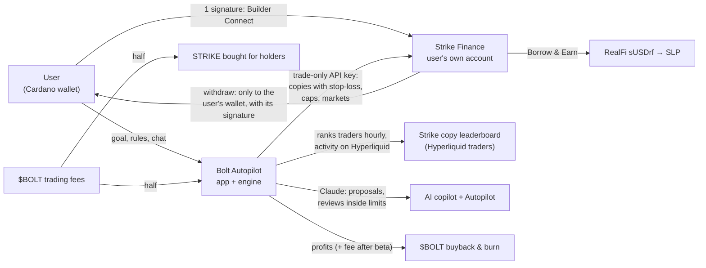

# Bolt Autopilot · Strike Hackathon submission

**The easiest way into Strike.**
Live: https://autopilot.boltstriker.io (private beta on Strike mainnet; anyone can run the demo)
Impact, flywheel and benchmark: https://autopilot.boltstriker.io/impact
Code: https://github.com/DrAlexDr/bolt-autopilot (private; judges are invited)
Builder code: `bolt_dev` · Team: the $BOLT community (X: @bolthestriker)

## One line

No Strike account and no trading experience needed: connect a Cardano wallet, say your goal, and Bolt Autopilot copies the best traders on Strike Finance for you, inside limits you choose, on your own Strike account. Bolt never holds your money.

## The problem

Strike's copy trading is powerful, but doing it well is hard. Hundreds of traders and their scores change every hour; sizing, leverage, stop-losses and markets are easy to get wrong; and copies need watching around the clock. Tools for people who already know Strike exist. Bolt is the way in for everyone else, and it keeps running by itself.

## What we built

**Getting in**
1. **One signature, no Strike account needed.** A Cardano wallet signs once; Strike opens the user's account (or links an existing one) through Strike's builder program. The API key Bolt receives can trade but never withdraw. ADA deposits and withdrawals happen inside Bolt; withdrawals go only to the wallet on the account, with its signature.
2. **Goals become rules, previewed first.** Risk (Low / Medium / High), goal (Steady / Balanced / Growth) and markets (all, crypto, or real-world: stocks, indices, gold, oil) set the budget at work, a leverage cap, a stop-loss on every copy and a daily loss limit, all enforced on Strike. Before any money moves, the panel replays the bot's current picks over the last 7 days, and tells the user how many ranked traders a copy of their size can follow well.
3. **A live demo for anyone:** $1,000 of pretend money that moves with the picked traders' live trading, Autopilot's decisions included. No wallet needed.

**Running by itself**
4. **A ranked engine.** Every hour it ranks Strike's copy leaderboard (Hyperliquid traders) by return per unit of drawdown × consistency; a walk-forward backtest on 877 traders chose this score (median return ÷ drawdown 44.6, against 7.7 for top returners). Activity is measured on Hyperliquid: picks must have traded in the last day, in at least 2 of the last 24 hours, with 70%+ of their trading in Strike's markets. They favour traders in a trade right now (a new copy opens their positions at once) and not losing this week, and copies are spread over different bets. Every 6 hours Bolt also scans all of Hyperliquid's leaderboard (47,536 traders) as a cross-check.
5. **AI copilot (Claude), in plain words.** "Stop when I'm up $20", "pause until Monday", "copy at 2x", "never copy that trader again", "how am I doing?", "stop the bot". The copilot reads the bot's traders, the account's live results and Strike's Earn rates, then proposes a full rule set or a one-tap action. Nothing changes until the user taps it.
6. **AI Autopilot, inside hard limits.** Claude reviews the bot when something calls for it (a trader leaving the ranking, a copy near its stop-loss, losses near the daily limit, a daily check) and may swap a trader or step risk down. A validator clamps anything looser than the user's own settings; it never touches their targets, schedule or blocked traders; a plain-rules version takes over if Claude is unavailable.
7. **Rules the engine enforces:** stop the whole bot at +$X or −$X since Start (copies that already ended count), a daily profit target, timed pauses, weekdays only, a block list, and 1×–3× copy size capped by risk level.

**Trust you can see**
8. **Every decision explained.** Each Autopilot review shows its trail: why it looked, who decided (Claude or the rules), what changed, the limits check, and what Strike then did.
9. **Nothing fails silently.** Strike's own reasons for any order it couldn't copy appear in the activity feed; a health badge (Healthy / Watch / Needs attention / Paused) and in-page notices show what the bot just did; profit is shown since the account started, deposits excluded.
10. **Trader window.** Click any trader to name them and see Bolt's numbers, their 30-day profit, open positions, recent trades, how active they are and how much of their trading a Strike copy can follow, plus Switch trader.

**Growth and $BOLT**
11. **Share your setup:** a link that starts a friend with your rules (their own budget), with your verified result from a real account. Result cards for X are read from the server, so they can't be faked.
12. **Earn on Strike:** how much money is in copies, idle and earning, and three ways to earn with live rates: Strike's SLP vault, RealFi's sUSDrf through Borrow & Earn (deposited in one signature from Bolt), and STRIKE staking.
13. **The $BOLT flywheel: trading $BOLT buys STRIKE.** Every $BOLT trade pays a fee: half buys STRIKE for $BOLT holders (₳8.49K of STRIKE so far, buying pressure on Strike's own token), and half funds the bot that copy-trades on Strike with real money; its profits buy back and burn $BOLT (8.24M so far). Autopilot adds its users' volume on Strike, and after the beta a small Bolt fee on their trades. Holding 1M $BOLT unlocks Autopilot and its perks after the open launch days. Live on the landing and impact pages.

## Why it matters for Strike

Every Bolt user is a Strike user: new accounts through our builder code, copy-trading volume on Strike's engine, deposits from people who'd never have opened Strike on their own, and RealFi liquidity in Borrow & Earn. And every $BOLT trade buys STRIKE for holders. Bolt is the layer on top; Strike stays the engine, the custody and the source of truth.

We track it in public at **https://autopilot.boltstriker.io/impact**: accounts opened through Bolt, copy-trading volume, the live bot's real result, the $BOLT flywheel and RealFi liquidity, every number labelled (real trades, live count, on-chain, Strike-wide, paper).

**Proof, in public: Bolt vs the leaderboard.** Since Oct 21 a scheduled job tracks two $1,000 paper portfolios forward on Strike's live data: Bolt's engine against copying the top 10 by 30-day return, with the same fee and slippage model. The impact page shows both, whatever they say.

## Traction (Oct 23)

- The same engine has run the $BOLT bot on Strike with **real money since Oct 16**: $700 across 4 copies, **+$18** today.
- **$16.5K copy-trading volume** and 237 copy trades on Strike from the live bot, plus $2.3K from Autopilot's first beta accounts.
- **287 $BOLT holders**, ₳583K token volume, ₳8.49K paid to holders in STRIKE, 8.24M $BOLT burned, 36 holder demo bots and 23 Bot Cup players.

## How it works

- **Site:** Next.js 16 on Vercel. Wallets via CIP-30; transactions are signed in the wallet and witnesses merged without re-encoding the body.
- **Worker:** Node 22 in Docker on our own server (Hetzner, Caddy for HTTPS, nightly snapshots, uptime checks every 15 minutes). Strike API with Ed25519 API-wallet signing; per-user keys encrypted (AES-256-GCM); each user's copies synced every 2 minutes.
- **Engine:** shared with the live $BOLT bot (`bot/strategy.ts`); Autopilot rules in `worker/autopilot.ts`, the sync in `worker/autopilotEngine.ts`, the AI review in `worker/autotune.ts`; 138 unit tests.
- **AI:** Anthropic's Claude via the official SDK, strict tools, rate-limited and proposal-only for the copilot; Autopilot's decisions pass a validator before anything applies.
- **Benchmark:** `bot/benchmark.ts`, run every 6 hours by a GitHub Action, served on the impact page.

## Safety

Non-custodial accounts, a trade-only key, withdrawals only to the user's own wallet, a stop-loss and caps on every copy, a daily loss limit, whole-bot stop targets, one button to stop, encrypted keys, an AI that can only act inside the user's own limits, and a $500 per-user cap during the beta.

## What's next

- **Next:** holder access (1M $BOLT) after the launch days; the Bolt fee on Autopilot trades feeding buybacks and burns; deposit any Cardano token (SteelSwap swaps it to ADA, then into Strike; built, in testing); copilot trades with a second opinion (checked against what Strike's top traders hold, the market and the user's limits); alerts on Telegram.
- **Bolt Vault:** Autopilot's engine as a vault on Strike, its performance fee buying back and burning $BOLT, holders first. With the Strike team.
- **Social copy trading:** traders post their thesis and analysis; users follow the reasoning, discuss it and copy with conviction. A FOMO-style feed for copy trading.
- **Inside Cardano wallets:** Autopilot as a "Trade" tab in wallets, with Strike's builder fee shared with the wallet. **Playable now** as a hidden concept: https://autopilot.boltstriker.io/wallet (or type "wallet" on the landing page): a phone with a wallet whose Trade tab opens a Strike account with one signature and runs Bolt's real picks with practice money.
- A liquidation check in the rules preview, and a weekly review from the copilot.

*Bolt is a community project built on Strike's public tools; it is not made or endorsed by Strike Finance or RealFi. Copy trading can lose money.*
