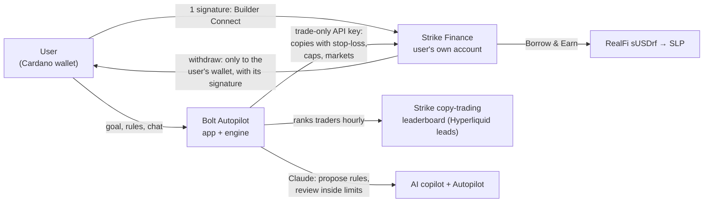

# Bolt Autopilot · Strike Hackathon submission

**Copy trading on Strike, on autopilot.**
Live: https://autopilot.boltstriker.io (private beta on Strike mainnet; anyone can run the demo)
Impact and benchmark: https://autopilot.boltstriker.io/impact
Code: https://github.com/DrAlexDr/bolt-autopilot (private; judges are invited)
Builder code: `bolt_dev` · Team: the $BOLT community (X: @bolthestriker)

## One line

Say your goal and Bolt Autopilot copies the best traders on Strike Finance for you, inside hard limits you choose, on your own Strike account: Bolt never holds your money.

## The problem

Strike's copy trading is powerful, but doing it well is hard. Hundreds of traders and their scores change every hour, sizing and limits (leverage, stop-losses, markets) are easy to get wrong, and copies need watching around the clock.

## What we built

1. **One-signature onboarding (Builder Connect).** A Cardano wallet signs once; Strike opens the user's account (or links an existing one) through Strike's builder program. The API key Bolt receives can trade but never withdraw.
2. **Goals become rules, previewed before any money moves.** Users pick a risk level (Low / Medium / High), a goal (Steady / Balanced / Growth) and markets (all, crypto, or real-world: stocks, indices, gold, oil). That sets the budget at work, the leverage cap, a stop-loss on every copy and a daily loss limit, all enforced on Strike. While they choose, the panel replays the bot's current picks for those exact rules over the traders' last 7 days on Strike (copy sizes, stop-losses, profit lock and daily limit included): "if you'd started 7 days ago", with the result, the worst dip and a chart.
3. **A ranked engine.** Every hour it ranks Strike's top traders by return per unit of drawdown × consistency, keeps only traders a copy can follow at the user's size, who are active and trade markets Strike lists, and it holds what works (no churn when rankings reshuffle). A walk-forward backtest on 877 traders picked this score: median return ÷ drawdown 44.6, versus 7.7 for picking top returners. Backtests don't promise future results.
4. **AI copilot (Claude).** Users describe what they want in their own words; the copilot reads the bot's current traders and Strike's live Earn rates and proposes a full rule set. It never applies anything itself: every proposal has an Apply button.
5. **AI Autopilot, inside hard limits.** In Autopilot mode Bolt also looks after the setup: when a trader leaves the ranking, a copy nears its stop-loss, losses near the daily limit, or once a day, Claude reviews the bot through one forced tool and may swap a trader, step risk down, or return to the user's own settings. Every decision passes a validator that clamps anything looser than the user's settings (budget, risk, leverage, stop-loss, daily limit, markets), and every change lands in the activity feed with its reason. If Claude is unavailable, a plain-rules version decides, so the bot never stalls. Switching back to "Follow my rules" undoes it.
6. **Earn with RealFi on Strike.** Money the bot isn't using can earn. Bolt shows RealFi's sUSDrf yield (≈11.9%, measured by Strike) next to SLP's APR (≈21%), reads the user's sUSDrf balance, deposits sUSDrf to their Strike account in one signature, and tracks the position. One-tap Pledge & earn is next, on the RealFi API Strike is adding.
7. **Deposit and withdraw inside Bolt.** ADA in with one signature and a step-by-step progress window; withdrawals only to the wallet registered on the account, only with its signature. Money in running copies returns to the balance when they stop.
8. **A live demo for anyone.** $1,000 of pretend money that starts when you press Start and moves with the picked traders' live trading (stop-losses, profit lock, daily limit and Autopilot's swaps included), so judges can try it without a wallet.
9. **Share cards.** A result card for X with the return, the rules and Bolt's mood for the day; demo cards are labelled as such, and real cards are read from the server, so a result can't be faked.

## Why it matters for Strike

Every Bolt user is a Strike user: new accounts through our builder code, copy-trading volume on Strike's engine, and RealFi liquidity in Strike's Borrow & Earn. Bolt is the intelligence layer; Strike stays the engine, the custody and the source of truth.

We track it in public: **https://autopilot.boltstriker.io/impact** shows, live from Strike's API, the Bolt server and Cardano, the Strike accounts opened through `bolt_dev`, copy-trading volume, the live bot's real result and RealFi liquidity.

**Proof, in public: Bolt vs the leaderboard.** Since Oct 21 a scheduled job tracks two $1,000 paper portfolios forward on Strike's live data every 6 hours: Bolt's own engine against copying the top 10 traders by 30-day return (what most people do by hand), with the same fee and slippage model. The impact page shows both curves, their worst drops and return per unit of drop, whatever they say.

## Traction

- The same engine has run the $BOLT bot on Strike with **real money since Oct 16**.
- **$13.4K copy-trading volume** and 161 copy trades on Strike so far (Strike API, Oct 22).
- **281 $BOLT holders**, ₳900K+ token trading volume, ₳8.1K paid to holders in STRIKE, and a Bot Cup where holders run demo bots on live Strike traders.

## How it works

- **Site:** Next.js 16 on Vercel (autopilot.boltstriker.io). Wallets via CIP-30; Cardano transactions are signed in the wallet and witnesses merged without re-encoding the body.
- **Worker:** Node 22 on Railway. Strike API with Ed25519 API-wallet signing; per-user keys stored encrypted (AES-256-GCM). Syncs each user's copies every 5 minutes, from the user's own Strike account.
- **Engine:** shared with the live $BOLT bot (`bot/strategy.ts`), with Autopilot rules in `worker/autopilot.ts` and the AI review in `worker/autotune.ts`; 121 unit tests.
- **Copilot and Autopilot:** Anthropic's Claude via the official SDK. The copilot uses strict tools (propose rules, read traders, read Earn rates), rate-limited and proposal-only; Autopilot's review uses one forced decision tool, checked by a validator before anything applies.
- **Benchmark:** `bot/benchmark.ts`, run every 6 hours by a GitHub Action, results committed to the repo and served on the impact page.

## Safety

Non-custodial accounts, a trade-only key, withdrawals only to the user's own wallet, a stop-loss and caps on every copy, a daily loss limit, one button to stop, encrypted keys, an AI that can only act inside the user's own limits, and a $500 per-user cap during the beta.

## What's next

- Public beta, and one-tap RealFi Pledge & earn on Strike's new API.
- **Inside Cardano wallets:** Autopilot as a "Trade" tab in wallets like VESPR (a concept is ready), with Strike's builder fee shared with the wallet, the model that made in-wallet perps the top earner on Hyperliquid.
- **Bolt Clans:** holders' Autopilot bots on group leaderboards, building on the Bot Cup.
- With the Strike team, a **Bolt Autopilot Vault**: a Strike vault run by the engine, so anyone can join with a deposit on Strike itself.

*Bolt is a community project built on Strike's public tools; it is not made or endorsed by Strike Finance or RealFi. Copy trading can lose money.*
